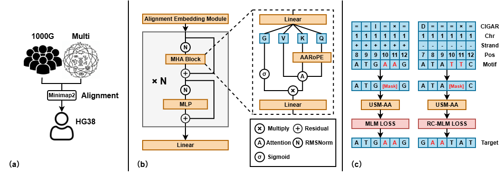

<div align="center">

# USM-AA

**Alignment-Aware Genomic Coordinate Encoding for Long-Range DNA Modeling**

[](https://www.python.org/downloads/)
[](https://pytorch.org/)
[](https://www.deepspeed.ai/)
[](https://creativecommons.org/licenses/by-nc/4.0/)

*A powerful DNA sequence pretrain model with Flash Attention support*

[Quick Start](#quick-start) · [Data Preparation](#data-preparation) · [Training](#training) · [Usage](#extract-embedding)

</div>

---

## Overview

<div align="center">

</div>

USM-AA is a Transformer-based encoder model pretrained on a combination of the **human reference genome**, **population-scale genomes from 1000 Genomes Project**, and **reference genomes from multiple species**.

### Key Innovations

- **AARoPE (Alignment-Aware Rotary Position Embedding)**: A novel position encoding method designed specifically for genomic coordinates, enabling the model to capture long-range dependencies across both contiguous and non-contiguous genomic regions.

- **Alignment Embedding Module**: Processes alignment information including CIGAR strings, strand orientation, chromosome identifiers, and absolute genomic coordinates from Minimap2 alignment results.

- **RC-MLM (Reverse-Complement Masked Language Modeling)**: A specialized pretraining objective where forward-strand sequences are predicted normally, while reverse-strand sequences require reverse-complement predictions at masked positions.

As a result, USM-AA is better suited to interpret genomic sequences in the context of the reference genome, capturing both sequence content and coordinate-aware genomic structure. It achieves **excellent performance on multiple downstream tasks**.

---

## Features

- **DNA Sequence Modeling** - State-of-the-art pretrained model for DNA sequences
- **AARoPE** - Alignment-aware position encoding for genomic coordinates
- **Alignment Embedding** - Incorporates alignment information (CIGAR, strand, chromosome)
- **Flash Attention** - Optimized attention mechanism for faster training
- **DeepSpeed Integration** - Distributed training with ZeRO optimization
- **Multi-species Support** - Train on diverse genomic datasets
- **Easy to Use** - Simple API for embedding extraction

---

## Quick Start

### Installation

```bash
# Create conda environment
conda create -n usmaa python=3.9 -y
conda activate usmaa

# Install dependencies
pip install -r requirements.txt

# Install Flash Attention (for faster training)
pip install flash-attn --no-build-isolation
```

---

## Data Preparation

> All data processing scripts are located in the `scripts/` directory.

### Quick Start

```bash
# Prepare all data at once
bash scripts/prepare_data.sh all

# Or prepare individual datasets
bash scripts/prepare_data.sh ref   # Reference genome only
bash scripts/prepare_data.sh dna   # DNA alignment data only
bash scripts/prepare_data.sh 1kg   # 1000 Genomes data only
```

### Configuration

Edit the paths in `scripts/prepare_data.sh`:

```bash
# Input files
REF_INPUT="/path/to/grch38.fasta"          # GRCh38 reference genome
DNA_INPUT="/path/to/dna_sequences.txt"      # DNA sequences (one per line)
VCF_DIR="/path/to/1kgenomes/vcf"           # 1000 Genomes VCF directory

# Output directory
OUTPUT_DIR="./data"
```

---

### 1. Reference Genome

Process the GRCh38 human reference genome:

```bash
bash scripts/prepare_data.sh ref
```

| Type | Description |
|------|-------------|
| **Input** | GRCh38 FASTA file |
| **Output** | `data/ref.fasta` + `data/ref.fasta.idx` |

---

### 2. 1000 Genomes Project

Extract SNP and INDEL variants from 1000 Genomes Project VCF files:

```bash
bash scripts/prepare_data.sh 1kg
```

| Type | Description |
|------|-------------|
| **Input** | 1000 Genomes phased VCF directory |
| **Output** | `data/1kg.jsonl` + `data/1kg.jsonl.idx` |

> **Note**: This step may take a long time due to the large data volume (~3,200 samples).

<details>
<summary>Output Format</summary>

Each record contains:
- `sample_id` - Sample identifier
- `chrom` - Chromosome number
- `variants` - List of variant positions

</details>

---

### 3. Multi-species DNA

Process multi-species DNA sequences with alignment information:

```bash
bash scripts/prepare_data.sh dna
```

| Type | Description |
|------|-------------|
| **Input** | Text file with one DNA sequence per line |
| **Output** | `data/dna.jsonl` + `data/dna.jsonl.idx` |

---

## Training

### Configuration Files

USM-AA uses YAML configuration files to control training. Different configs are provided for pretraining and finetuning:

| Config | Description |
|--------|-------------|
| `configs/usmaa_100m_pretrain.yaml` | Pretraining on reference genome + 1KG + multi-species DNA |
| `configs/usmaa_100m_finetune.yaml` | Finetuning on downstream classification tasks |

### Pretraining

```bash
bash scripts/train.sh configs/usmaa_100m_pretrain.yaml
```

### Finetuning

```bash
# Modify configs/usmaa_100m_finetune.yaml for your task:
#   - dataset.data_dir: path to your data
#   - dataset.num_classes: number of classes
#   - model.checkpoint: path to pretrained model

bash scripts/train.sh configs/usmaa_100m_finetune.yaml
```

---

## Extract Embedding

```python
from embedding import USMAA

# Load pretrained model
model, tokenizer = USMAA.from_pretrained(
    config_path="config.yaml", 
    checkpoint_path="/path/to/model.safetensors",
    device="cuda"
)

# Encode DNA sequence
dna = "ACGTAGCATCGGATCTATCTATCGACACTTGGTTATCGATCTACGAGCATCTCGTTAGC"
inputs = tokenizer(dna, return_tensors='pt')
hidden_states = model(inputs["input_ids"].to("cuda"))[0]

# Mean pooling for sequence embedding
embedding = hidden_states.mean(dim=1)
print(f"Embedding shape: {embedding.shape}")
```

---

## Project Structure

```
usm-aa/
├── configs/          # Model & training configurations
├── scripts/          # Data processing & training scripts
├── src/
│   ├── bio/          # Bioinformatics utilities
│   ├── config/       # Configuration management
│   ├── data/         # Dataset classes
│   ├── distributed/  # Distributed training utilities
│   ├── engine/       # Training engine
│   ├── evaluator/    # Evaluation metrics
│   ├── loss/         # Loss functions
│   ├── model/        # Model architecture
│   ├── tokenizer/    # K-mer tokenizer
│   └── utils/        # General utilities
└── requirements.txt  # Dependencies
```

---

## License

This project is licensed under the [CC BY-NC 4.0](https://creativecommons.org/licenses/by-nc/4.0/) (Creative Commons Attribution-NonCommercial 4.0 International) License.

You are free to:
- **Share** — copy and redistribute the material in any medium or format
- **Adapt** — remix, transform, and build upon the material

Under the following terms:
- **Attribution** — You must give appropriate credit
- **NonCommercial** — You may not use the material for commercial purposes